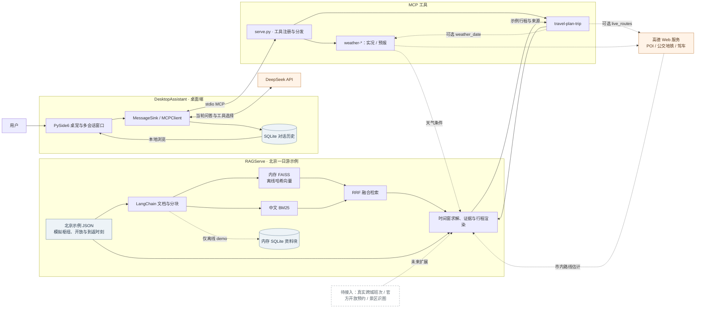

# MCP_MOD

一个以桌面助手为入口的 Python 项目。包含 PySide6 鲸鱼娘桌宠、多会话聊天、天气 MCP 服务和可离线运行的 FAISS/LangChain 旅行 RAG 示例。桌宠支持六种可手动选择的动画、对话气泡与本地会话记录；旅行规划可按需查询高德市内路线和天气。跨城班次仍待接入。

## 模块与进度

| 模块 | 位置 | 当前状态 |
| --- | --- | --- |
| 桌面助手 | [DesktopAssistant](DesktopAssistant/README.md) | 鲸鱼娘动画桌宠、圆角气泡、动作菜单、多会话聊天记录、LLM/MCP 客户端；MCP 服务注册天气与 `travel-plan-trip` 旅行工具 |
| 天气工具 | [weather](weather/README.md) | 高德实况与预报查询，接入桌面助手 MCP 服务；`get-alerts` 当前实际返回实况，尚无预警查询 |
| 旅行 RAG 示例 | [RAGServe](RAGServe/README.md) | 旅行资料准备、SQLite 分块存取、FAISS 建索引、中文 BM25 融合检索和可行时间轴生成；默认使用模拟北京资料与离线输出 |
| 旅行规划 | [架构设计](RAGServe/TRAVEL_RAG_ARCHITECTURE.md) | 离线示例已跑通，可选实时高德 POI/公交地铁优先或驾车路径和天气预报；跨城班次、真实景区知识库尚未接入 |
| 旅行规划 skill | [.agents/skills/travel-rag-planner/SKILL.md](.agents/skills/travel-rag-planner/SKILL.md) | 已提供规划流程和结果校验规则；skill 不会自行提供实时数据 |
| 景区识图 | 架构设计中的后续阶段 | 尚未实现 |

## 项目整体架构



实线表示当前调用和数据流；带文字的虚线分别表示按参数启用的实时查询、仅离线 demo 使用的分块 SQLite，以及尚未接入的目标能力。聊天历史 SQLite 与旅行资料分块 SQLite 彼此独立；历史目前只用于本地查看，不会自动作为上下文发给模型。MCP 旅行工具启动时从示例 JSON 构建内存 FAISS，跨城到返时刻和景区开放时间仍是模拟值。

## 目标流程

```text
出发地、目的地、日期、时间预算
  -> 高铁/机场候选落地点与真实班次（班次需独立数据源）
  -> 高德 POI 和市内交通耗时
  -> 天气 MCP 与开放时间等约束
  -> FAISS/LangChain 检索本地景区资料
  -> 时间可行的景点顺序、景区内细节与来源说明
```

当前 MCP 旅行工具在内存中构建 FAISS 索引；离线 demo 另用内存 SQLite 演示资料分块存取。后续持久化时，文档、景点、来源、索引版本和行程记录建议由 SQLite 管理。高德 Web 服务用于 POI 与市内步行、公交、驾车等路线，不把它当作高铁/航班实时班次或景区内部导览的权威来源。详见[旅行 RAG 架构](RAGServe/TRAVEL_RAG_ARCHITECTURE.md)。

## 本地运行

统一使用 `DesktopAssistant/pyproject.toml`、`DesktopAssistant/uv.lock` 和 `DesktopAssistant/.venv`。在项目根目录运行：

```powershell
uv sync --project DesktopAssistant
uv run --project DesktopAssistant python -m RAGServe.demo
```

运行桌宠：`uv run --project DesktopAssistant python DesktopAssistant/main.py`。从项目根目录执行上述命令，可让 Python 找到同级的 `RAGServe` 和 `weather` 模块。不要再对根目录执行 `uv sync`；天气目录的独立项目清单不用于桌宠启动。

桌宠调用模型时需设置 `DEEPSEEK_API_KEY`；天气与高德实时路线需设置 `AMAP_API_KEY`。PowerShell 示例：

```powershell
$env:DEEPSEEK_API_KEY = "你的模型密钥"
$env:AMAP_API_KEY = "你的高德密钥"
uv run --project DesktopAssistant python DesktopAssistant/main.py
```

未配置模型密钥时，桌宠仍可显示，聊天后端会提示未连接。默认旅行示例不需要外部 API Key。首次启动的 MCP 连接在窗口绘制后进行；聊天记录保存在本地 SQLite，不会随代码提交。

路线请求默认复用天气模块已有的高德 Web 服务 Key；如需覆盖，可设置 `AMAP_API_KEY`。用 `--live-routes` 查询高德 POI 与市内公交/地铁优先耗时；可用 `--route-mode driving` 改为驾车。`--weather-date YYYY-MM-DD` 读取现有天气 MCP 的指定日期预报。两个实时选项都可省略，默认不访问外网。公交/地铁无路线时不会自动改为驾车。天气接口的申请额度为每月 5000 次；路线与 POI 的权限、额度需在高德控制台单独核对。

2026-09-29 使用共用 Key 各发起一次真实公交路线和天气预报请求，两项均返回成功；这仅是接口联通检查，未验证完整旅行路线矩阵或未来时段的实际耗时。

用户提供的高德控制台 HTML 快照中的相关配额、调用量和单次规划请求预算，见[高德用量记录](RAGServe/AMAP_USAGE.md)。

桌宠聊天通过现有 MCP 客户端自动发现 `travel-plan-trip`。工具输入 `query`（必填）、`city`（当前仅北京）、`live_routes`（默认 `false`）、`route_mode`（默认 `transit`）、`weather_date`（可选）。可直接说“北京一日游，想去故宫和景山公园”；未启用实时选项时返回明确标注模拟数据的示例行程。当前没有跨城出发城市、车次和票价的真实输入，不能判断当天往返。

离线示例用内存 SQLite 存取景区资料块，再构建 FAISS 索引。示例中的跨城到达/返程时刻和景区开放时间仍为模拟值；默认的城市接驳和天气也为模拟值，不能用于真实订票或出行决策。桌宠的单独启动方式见 [DesktopAssistant/README.md](DesktopAssistant/README.md)。天气 MCP 的工具实现位于 `weather/weather_serve.py`。源码现从环境变量读取 API 凭据；曾写入本地文件或源码的旧凭据应在服务控制台轮换。

## 下一阶段

西安小红书笔记的授权导入和 RAG 存储方案见 [西安景点笔记入库方案](RAGServe/XIAOHONGSHU_INGEST.md)。当前站点 robots 规则不允许通用爬虫访问 `/explore`；在线命令会先核对规则并停止，可导入有权处理的 JSONL 数据。

1. 用经核验的景区资料替换模拟 JSON，并给资料增加官方来源和更新时间。
2. 评估经授权的跨城车次/航班数据源（例如 [飞常准 Tripmatch MCP](https://mcp.variflight.com/docs/tripmatch)），取得凭据后用真实到发时刻取代示例时刻；票额与实际可订状态仍需临近出行核验。
3. 联调真实高德、天气接口，并将官方开放/预约信息传入现有行程求解器。
4. 在有足够标注图像与景点定位数据后探索景区识图。
